# hookbin CLI

Forward webhooks from [hookbin](https://hookbin.madebyflow.de) to the app on your laptop. Inspect every request,
see how your app answered, and replay it until your handler gets it right. No tunnel, no open port.

<p align="center"></p>

## Install

macOS, Linux, and Windows with Git Bash or WSL:

```sh
curl -fsSL https://hookbin.madebyflow.de/cli/install | sh
```

The installer downloads the latest release for your system, verifies its SHA-256 checksum, and puts `hookbin` in
`~/.local/bin`. Add that folder to your `PATH` if your shell does not have it yet.

Prefer to build it yourself? With Go 1.22 or later: `go build -o hookbin ./cmd/hookbin`.

## Quick start

1. Open [hookbin.madebyflow.de](https://hookbin.madebyflow.de) and create a webhook URL.
2. Give that URL to Stripe, GitHub, or any other provider.
3. Copy the command from the inspector and run it next to your app:

```sh
HOOKBIN_SECRET='<bin secret>' hookbin listen <slug> -f http://localhost:3000
```

Every webhook sent to the bin now reaches `http://localhost:3000`, path included: `/stripe` arrives at
`http://localhost:3000/stripe`. Your app's answer shows up in the inspector, where you can replay the request.

On Windows in Git Bash, run the binary by path: `HOOKBIN_SECRET='<bin secret>' ~/.local/bin/hookbin.exe listen <slug> -f http://localhost:3000`.
In WSL, `localhost` reaches apps inside WSL; for an app running on Windows, turn on mirrored networking or use the
Windows host address.

## Options

```
hookbin listen <slug> [flags]
```

| Flag | Meaning |
| --- | --- |
| `-f, --forward-to` | Local URL that receives the webhooks. Required. |
| `-s, --secret` | Bin secret. Prefer the `HOOKBIN_SECRET` environment variable, so it stays out of your shell history. |
| `--server` | hookbin server to connect to. Default `https://hookbin.madebyflow.de`. |
| `--timeout` | How long to wait for your app to answer. Default `10s`. |
| `--insecure` | Accept a self-signed HTTPS certificate on the local target. |

The target can be changed from the inspector while the CLI runs; it switches without a restart.

## How it connects

The CLI opens one outgoing, encrypted WebSocket connection to hookbin and authenticates with the bin secret.
Your machine accepts no incoming connections and opens no port. The CLI reconnects after short connection drops
and stops when the bin expires. The wire format is documented in [PROTOCOL.md](PROTOCOL.md).

## Updating

Released builds check GitHub for a newer version when `hookbin listen` starts and show a notice if one exists.

```sh
hookbin update --check  # check without installing
hookbin update          # download, verify, and install the latest release
```

The updater verifies the archive against its published SHA-256 checksum before replacing the executable. Restart a
running CLI afterwards.

## Development

```sh
go test ./...
go run ./cmd/hookbin listen <slug> --secret <secret> -f http://localhost:3000 --server http://localhost:8080
```

To release, push a version tag. The workflow tests the source, builds archives for Linux, macOS, and Windows, and
publishes them with SHA-256 checksums.

```sh
git tag -a v0.1.4 -m "v0.1.4"
git push origin v0.1.4
```

## License

[MIT](LICENSE)
